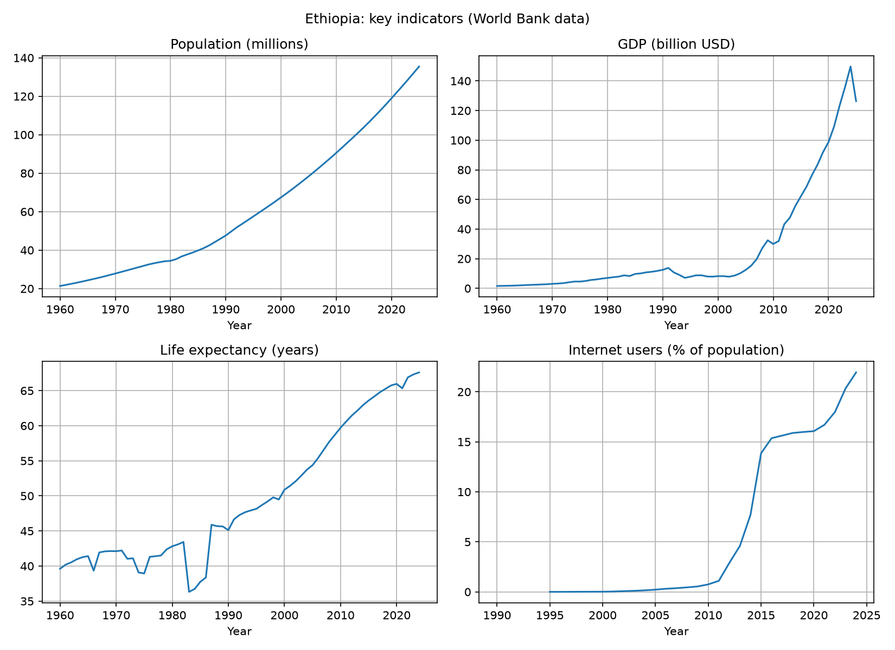

# Ethiopia Data Analysis (SQL + Python)

A small data project by Yonas Dargie Tegegn. It loads World Bank indicators for Ethiopia into a SQLite database, answers questions with SQL, and draws charts with Python.

## Data
World Bank Open Data, for Ethiopia (https://data.worldbank.org):
- Population (SP.POP.TOTL)
- GDP in current USD (NY.GDP.MKTP.CD)
- Life expectancy at birth (SP.DYN.LE00.IN)
- Internet users, % of population (IT.NET.USER.ZS)

## Tools
Python, pandas, matplotlib, SQLite (SQL)

## Files
- `load_db.py`: reads the 4 CSV files and builds the database `ethiopia.db`
- `queries.py`: SQL queries (filtering, grouping by decade, GDP per person)
- `charts.py`: draws 4 line charts and saves `ethiopia_charts.png`

## How to run
1. `pip install pandas matplotlib`
2. `python load_db.py`
3. `python queries.py`
4. `python charts.py`

## Results

